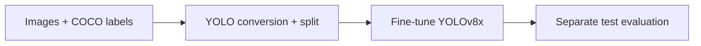

# Thermal Image Anomaly Detection

A YOLOv8x pipeline for detecting normal and anomalous regions in thermal images.

**Computer vision · Object detection · Ultralytics**

Course project for **ITE4052 Computer Vision, Hanyang University ERICA**, Sep–Dec 2025.

[Results](#reported-results) · [Pipeline](#pipeline) · [Run](#getting-started) · [Implementation](main.py)

## Result Snapshot

| Reported test run | mAP50–95 | Precision | Recall |
| :--- | ---: | ---: | ---: |
| Seed 0 | **0.7942** | 0.9687 | 0.6809 |

Historical result from the original project report. [Evaluation details and other runs](#reported-results).

## Overview

The project converts COCO annotations into YOLO labels, fine-tunes a detector, and evaluates predictions on a separate test set. The implementation combines data preparation, training, and evaluation in one script.

| Component | Implementation |
| :--- | :--- |
| Detector | YOLOv8x by default |
| Classes | `normal` and `anomaly` |
| Training/validation split | 90/10, stratified by the presence of anomaly annotations |
| Input size | 640 pixels |
| Optimizer | SGD; initial learning rate 0.0008 |
| Augmentation | Small color and geometric changes; mosaic and mixup disabled |
| Test summary | mAP50–95, precision, recall, and a weighted project score |

## Pipeline



The augmentation settings are deliberately modest. They are a design choice for this project; the repository does not include an ablation showing that they outperform alternative settings.

## Reported Results

The original README contained both validation tables and separate test summaries. They are separated below to avoid treating them as the same evaluation.

### Validation

The original report describes 300 validation images, with 150 images per class.

| Reported run | Overall mAP50 | Overall mAP50–95 |
| :--- | ---: | ---: |
| Seed 0 | 0.995 | 0.971 |
| Seed 1 | 0.991 | 0.971 |
| Seed 2 | 0.995 | 0.972 |

### Test

| Reported run | mAP50–95 | Precision | Recall | Project score |
| :--- | ---: | ---: | ---: | ---: |
| Seed 0 | 0.7942 | 0.9687 | 0.6809 | 0.8003 |
| Seed 1 | 0.7929 | 0.9616 | 0.6776 | 0.7982 |

The project score is `0.8 × mAP50–95 + 0.1 × precision + 0.1 × recall`; it is a project-specific summary, not a standard detection metric. A complete Seed 2 test summary was not provided in the original README.

These are historical reported values. Original logs, data, and checkpoints are not included, so their provenance cannot be audited here. The earlier implementation did not forward the requested seed to the Ultralytics trainer. Those historical run labels should not be taken as verified independent trainer seeds. The current implementation forwards the trainer seed and records both trainer and split seeds.

## Data Layout

Prepare the following files beneath the directory passed to `--workspace`:

```text
data/workspace/
├── images/
│   ├── train/
│   └── test/
├── train.json
└── test.json
```

Both JSON files must contain COCO-style `images`, `annotations`, and `categories`. Category names are mapped explicitly: `normal` → 0 and `anomaly` → 1, regardless of category order or original category IDs. Unknown or missing categories are rejected.

The source images and annotations are not distributed in this repository. Use `--workspace /path/to/data` if your data is stored elsewhere.

## Getting Started

```bash
git clone https://github.com/yunakinn/thermal-image-anomaly-detection.git
cd thermal-image-anomaly-detection
python -m venv .venv
source .venv/bin/activate
python -m pip install -r requirements.txt
```

### Train

```bash
python main.py --mode train --workspace ./data/workspace --model yolov8x.pt --epochs 30 --seed 0 --split-seed 42
```

Training creates a stratified 90/10 split using `--split-seed` (default 42) and forwards `--seed` to the YOLO trainer. Each run has a new timestamped directory under `--output-dir` (default `outputs`). The checkpoint is saved below that directory in `training/weights/best.pt`.

### Evaluate

```bash
python main.py --mode test \
  --workspace ./data/workspace \
  --weights /path/to/training-run/weights/best.pt \
  --seed 0
```

The test command prepares a separate dataset configuration and writes:

```text
outputs/test_<timestamp>/test_metrics.csv
outputs/test_<timestamp>/test_metrics.json
outputs/test_<timestamp>/run_config.json
```

Each invocation creates an independent run directory containing its converted dataset and configuration. `--run-dir` can specify a directory explicitly; nonempty directories are rejected and never deleted. Test evaluation explicitly uses `split="test"` and confidence threshold 0.001 for the precision–recall sweep. The earlier report used different evaluation settings; its historical scores are retained unchanged, not presented as rerun results.

## Repository Guide

| File | Purpose |
| :--- | :--- |
| [main.py](main.py) | Annotation conversion, splitting, training, and evaluation |
| [requirements.txt](requirements.txt) | Runtime dependencies |
| [LICENSE](LICENSE) | Repository license |

## Limitations

This is a two-class course project on a specific thermal dataset. Performance on other sensors or environments has not been established. The reported validation and test scores describe different splits and should not be compared as interchangeable results.


Regression checks use synthetic images and mocked YOLO calls: install `pytest`, then run `python -m pytest`. Full model training requires the private dataset and appropriate compute.
