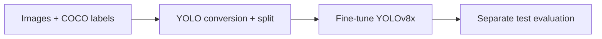

# Thermal Image Anomaly Detection

A YOLOv8x pipeline for detecting normal and anomalous regions in thermal images.

**Computer vision · Object detection · Ultralytics**

Course project for **ITE4052 Computer Vision, Hanyang University ERICA**, Sep–Dec 2025.

[Results](#reported-results) · [Pipeline](#pipeline) · [Run](#getting-started) · [Implementation](main.py)

## Result Snapshot

| Reported test run | mAP50–95 | Precision | Recall |
| :--- | ---: | ---: | ---: |
| Seed 0 | **0.7942** | 0.9687 | 0.6809 |

From the course project report (December 2025). [Evaluation details and other runs](#reported-results).

## Overview

The project converts COCO annotations into YOLO labels, fine-tunes a detector, and evaluates predictions on a separate test set. The implementation combines data preparation, training, and evaluation in one script.

| Component | Implementation |
| :--- | :--- |
| Detector | YOLOv8x by default |
| Classes | `normal` and `anomaly` |
| Training/validation split | 90/10, stratified by the presence of anomaly annotations |
| Input size | 640 pixels |
| Optimizer | SGD; initial learning rate 0.0008 |
| Augmentation | Small color and geometric changes; mosaic and mixup disabled |
| Test summary | mAP50–95, precision, recall, and a weighted project score |

## Pipeline



The project uses modest augmentation settings; their effect has not been evaluated in an ablation study.

## Reported Results

### Validation

The validation set has 300 images, 150 per class.

| Reported run | Overall mAP50 | Overall mAP50–95 |
| :--- | ---: | ---: |
| Seed 0 | 0.995 | 0.971 |
| Seed 1 | 0.991 | 0.971 |
| Seed 2 | 0.995 | 0.972 |

### Test

| Reported run | mAP50–95 | Precision | Recall | Project score |
| :--- | ---: | ---: | ---: | ---: |
| Seed 0 | 0.7942 | 0.9687 | 0.6809 | 0.8003 |
| Seed 1 | 0.7929 | 0.9616 | 0.6776 | 0.7982 |

The project score is `0.8 × mAP50–95 + 0.1 × precision + 0.1 × recall`; it is a project-specific summary, not a standard detection metric. The test summary for Seed 2 is not available.

These results are from the course project report; training logs, data, and checkpoints are not included. In that version the seed was not passed to the trainer, so Seeds 0–2 are best read as repeated runs rather than controlled seeded runs. The current code passes both the training and split seeds to the trainer and records them in `run_config.json`.

## Data Layout

Prepare the following files beneath the directory passed to `--workspace`:

```text
data/workspace/
├── images/
│   ├── train/
│   └── test/
├── train.json
└── test.json
```

Both JSON files must contain COCO-style `images`, `annotations`, and `categories`. Category names are mapped explicitly: `normal` → 0 and `anomaly` → 1, regardless of category order or original category IDs. Unknown or missing categories are rejected.

The source images and annotations are not distributed in this repository. Use `--workspace /path/to/data` if your data is stored elsewhere.

## Getting Started

```bash
git clone https://github.com/yunakinn/thermal-image-anomaly-detection.git
cd thermal-image-anomaly-detection
python -m venv .venv
source .venv/bin/activate
python -m pip install -r requirements.txt
```

To run the regression tests, install `pytest` and run `python -m pytest`. Tests use synthetic images and mocked YOLO calls, and run automatically on GitHub Actions for every push.

### Train

```bash
python main.py --mode train --workspace ./data/workspace --model yolov8x.pt --epochs 30 --seed 0 --split-seed 42
```

Training creates a stratified 90/10 split using `--split-seed` (default 42) and forwards `--seed` to the YOLO trainer. Each run has a new timestamped directory under `--output-dir` (default `outputs`). The checkpoint is saved below that directory in `training/weights/best.pt`.

### Evaluate

```bash
python main.py --mode test \
  --workspace ./data/workspace \
  --weights /path/to/training-run/weights/best.pt \
  --seed 0
```

The test command prepares a separate dataset configuration and writes:

```text
outputs/test_<timestamp>/test_metrics.csv
outputs/test_<timestamp>/test_metrics.json
outputs/test_<timestamp>/run_config.json
```

Each invocation saves its converted dataset, configuration, and results in a separate run directory. Use `--run-dir` to choose a directory; existing nonempty directories are rejected. Evaluation uses `split="test"` and a confidence threshold of 0.001. The reported scores above predate these settings and have not yet been reproduced with the current code.

## Repository Guide

| File | Purpose |
| :--- | :--- |
| [main.py](main.py) | Annotation conversion, splitting, training, and evaluation |
| [requirements.txt](requirements.txt) | Runtime dependencies |
| [LICENSE](LICENSE) | Repository license |

## Limitations

This is a two-class course project on a specific thermal dataset. Performance on other sensors or environments has not been established. The reported validation and test scores describe different splits and should not be compared as interchangeable results.
